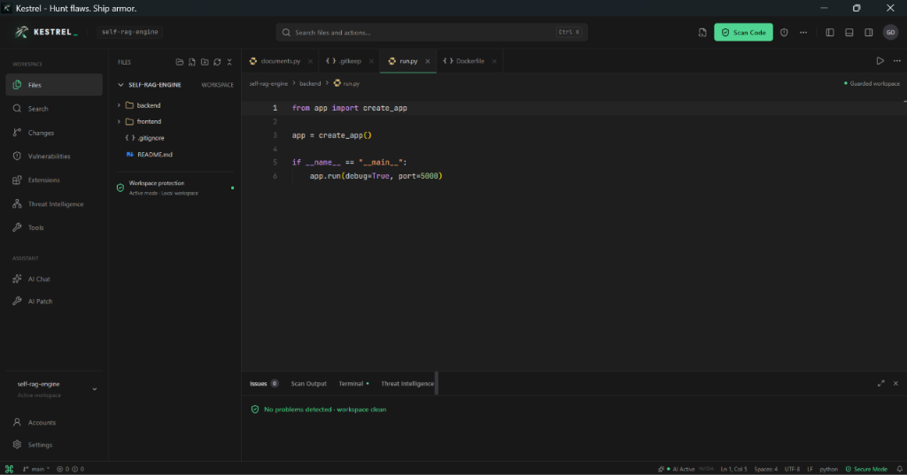
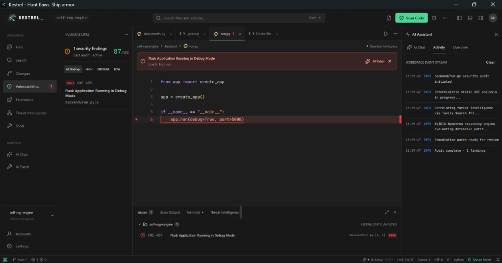
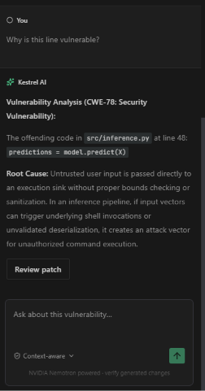
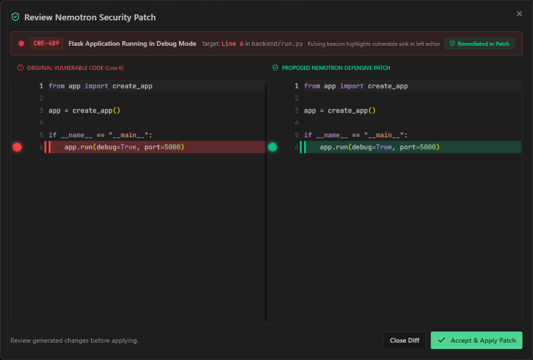
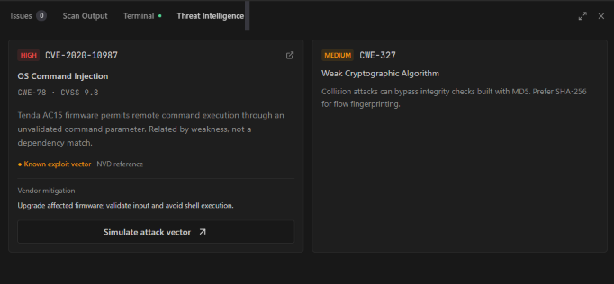

# Kestrel AI - Cybersecurity IDE & DevSecOps Engine

> **Hunt flaws. Ship armor.**  
> An AI-native cybersecurity IDE combining deterministic AST static analysis, real-time Tavily threat intelligence, and NVIDIA Nemotron defensive patch synthesis into an integrated desktop and web workspace.  
> **Official Website:** [https://kestrel-website-sigma.vercel.app/](https://kestrel-website-sigma.vercel.app/)

[](https://kestrel-website-sigma.vercel.app/)
[](#verification--test-suite)
[](#backend-requirements)
[](#backend-architecture)
[](#frontend-architecture)
[](#ai-reasoning-engine)
[](LICENSE)

<p align="center">
  
</p>

---

## Download Kestrel AI

[](https://kestrel-website-sigma.vercel.app/)
[-blue?style=for-the-badge&logo=windows)](https://github.com/Maazkorejo/Kestrel/releases/latest/download/Kestrel-Setup-1.0.0.exe)
[](https://github.com/Maazkorejo/Kestrel/releases/latest/download/Kestrel-1.0.0.exe)
[](https://github.com/Maazkorejo/Kestrel/releases)

### Quick Download Options

| Edition | Format | Target Platform | Description |
|---|---|---|---|
| **Official Website** | Web App | Modern Browsers | Live platform showcase, interactive tour, and documentation: [kestrel-website-sigma.vercel.app](https://kestrel-website-sigma.vercel.app/) |
| **Windows Setup** *(Recommended)* | `.exe` (NSIS) | Windows 10 / 11 (64-bit) | Standard installer wizard with automated Desktop icon and Start Menu shortcuts. |
| **Windows Portable** | `.exe` | Windows 10 / 11 (64-bit) | Zero-install standalone executable. Double-click and run immediately without admin rights. |
| **PowerShell One-Liner** | Script | Windows PowerShell | Run in terminal: `irm https://raw.githubusercontent.com/Maazkorejo/Kestrel/main/install.ps1 \| iex` |
| **Source Repository** | Git | Cross-platform | `git clone https://github.com/Maazkorejo/Kestrel.git` |

> **Note on Windows SmartScreen**: Because Kestrel is a community open-source release without an enterprise code-signing certificate, Windows Defender SmartScreen may display *"Windows protected your PC"*. Click **More info** -> **Run anyway** to launch. All binary releases are transparently built from open-source code via GitHub Actions CI.

---

## Overview

Modern software development and cybersecurity workflows are disjointed. Developers write code in IDEs, run disparate CLI scanners in separate terminal sessions, manually search CVE databases across browser tabs, and paste sensitive code snippets into generic AI chatbots that hallucinate false vulnerabilities.

**Kestrel AI** eliminates this friction. Inspired by VS Code and built for DevSecOps, Kestrel provides an end-to-end cybersecurity workspace where source code is audited by deterministic AST parsers, enriched with live threat intelligence, analyzed by NVIDIA Nemotron, and remediated with verified unified git diffs applied directly to disk with a single click.

---

## Product Showcase

### 1. Monaco IDE Workspace & Active Guarding
> Zero-latency local IDE environment featuring Monaco editor, file explorer, integrated terminal, and active workspace protection.

<p align="center">
  
</p>

### 2. Deterministic AST Security Audit & Event Stream
> Detects critical vulnerabilities like CWE-489 (Flask Debug Mode) directly in volatile memory with 0% LLM hallucination, streaming real-time workspace audit events.

<p align="center">
  
</p>

### 3. AI Vulnerability Deep-Dive & Root Cause Analysis
> Context-aware assistant powered by NVIDIA Nemotron 3.5 diagnosing execution sinks, untrusted input paths, and generating verifiable defensive patches for high-severity flaws like CWE-78.

<p align="center">
  
</p>

### 4. Side-by-Side Unified Git Diff Review
> Review proposed Nemotron defensive patches with clear line-by-line highlights before committing directly to disk with one click.

<p align="center">
  
</p>

### 5. Live Threat Intelligence Grounding & Exploit Simulation
> Queries Tavily in real time against authoritative NVD sources yielding live CVSS 9.8 severity metrics, known exploit vectors, vendor mitigations, and attack simulation triggers.

<p align="center">
  
</p>

---

## Key Capabilities

### 1. Deterministic Security Analyzers (Zero Hallucination)
- **Python AST Static Analysis:** Identifies SQL injection (CWE-89), command injection (CWE-78), path traversal (CWE-22), and insecure deserialization (CWE-502) in volatile memory.
- **AST Architectural Role Classifier:** Automatically categorizes code locations into `SINK`, `SOURCE`, `VALIDATION_GAP`, or `TRIGGER_POINT`.
- **High-Entropy Secrets Detector:** Flags leaked AWS tokens, OpenAI keys, JWT secrets, and database URIs with automatic redaction.
- **Cybersecurity Rule Linters:** Syntax validators and rulesets for YARA malware patterns, Sigma SIEM rules, and Snort network IDS rules.
- **Dockerfile Inspector:** Detects root user execution, unpinned base images, and dangerous package manager instructions.

### 2. Live Threat Intelligence Grounding (Tavily Search)
- When a vulnerability is detected, Kestrel automatically queries authoritative databases (NVD, MITRE, GitHub Security Advisories) via the Tavily Search API.
- Retrieves verified CVE IDs, published dates, CVSS severity scores, and official vendor mitigations.
- Includes an offline fallback using a curated Exploit-DB vulnerability reference catalog.

### 3. AI Reasoning & Defensive Remediation (NVIDIA Nemotron)
- Powered by `nvidia/nemotron-3.5-lightning` via OpenRouter and local Ollama routing.
- Synthesizes deterministic findings and live CVE records into plain-English root cause analyses and realistic attack vector breakdowns.
- Generates clean, production-ready unified git diff patches that preserve code style and functionality.
- **Ask AI Specialist:** In-editor conversational assistant strictly scoped to security analysis with prompt injection guardrails.

### 4. Dynamic Docker Exploit Sandbox & Attack Simulator
- Dispatches vulnerable code and synthesized patches into quarantined Docker containers or subprocess isolation sandboxes with resource and execution timeouts.
- Dynamic fuzzer and scenario runner executing simulated attack payloads (SQLi, command injection, path traversal) to verify patch efficacy.

### 5. Interactive Threat Modeling & Attack Trees
- Automatically extracts architectural data flows from sources through sanitizers into sinks.
- Generates node-and-edge attack trees rendered inside an interactive SVG visualizer.

### 6. Automated DevSecOps CI/CD Generator
- Generates customized GitHub Actions workflows (`.github/workflows/kestrel-audit.yml`) and GitLab CI configurations.
- Exports scan findings to the OASIS SARIF 2.1.0 standard for native GitHub Code Scanning alerts.

### 7. Production Authentication & Device Account Manager
- **OAuth 2.0 Integration:** Full web authorization flow with CSRF state verification for Google and GitHub.
- **PBKDF2 Password Hashing:** Salted SHA-256 credential authentication with device session tokens.
- **Multi-Account Switcher:** Instant local profile switching and offline Guest Mode.

### 8. Full Desktop Packaging
- Packaged as a standalone Windows desktop executable with an embedded FastAPI core engine (`kestrel-core.exe`), Electron wrapper, and NSIS installer (`Kestrel Setup 1.0.0.exe`).

---

## Architecture

Kestrel follows a modular, client-server architecture designed for zero data retention and maximum speed:

```
+-------------------------------------------------------------------------------+
|                           Kestrel Desktop (Electron)                          |
|                                                                               |
|  +---------------------------+             +-------------------------------+  |
|  |     Frontend Studio       |             |      FastAPI Backend Engine   |  |
|  |  (Vite + React + Monaco)  |<--- HTTP --->|    (kestrel-core / Port 8000)  |  |
|  +---------------------------+     JSON    +-------------------------------+  |
|               |                                            |                  |
|               v                                            v                  |
|   - Monaco Code Editor                     - backend/api/internal/            |
|   - Cyber Terminal CLI                       (workspace, auth, git, search,   |
|   - AI Inspector Panel                        terminal, settings, scanner,    |
|   - Sidebar File Explorer                     sandbox, cicd)                  |
|   - Threat Model Visualizer                - backend/api/external/            |
|   - Auth Gateway Modal                       (ai, remediation, intel,         |
|                                               threat_model, oauth)            |
+-------------------------------------------------------------------------------+
                                     |
                                     v
                 +---------------------------------------+
                 |           External Services           |
                 |  - NVIDIA Nemotron (OpenRouter)       |
                 |  - Tavily Threat Intelligence Search  |
                 |  - GitHub / Google OAuth Providers    |
                 +---------------------------------------+
```

---

## Quickstart Guide

### Prerequisites
- Python 3.11 or higher
- Node.js 18 or higher with npm

### 1. Clone the Repository
```bash
git clone https://github.com/Maazkorejo/Kestrel.git
cd Kestrel
```

### 2. Configure Environment Variables
Copy `.env.example` to `.env` and provide your API keys:
```bash
cp .env.example .env
```
Fill in the following keys:
- `NEBIUS_API_KEY`: Your OpenRouter or Nebius API key for NVIDIA Nemotron.
- `TAVILY_API_KEY`: Your Tavily Search API key for live CVE lookup.

### 3. Launch the Application

#### Option A: Quick Batch Launcher (Windows)
```cmd
run_studio.bat
```
This automatically activates the Python virtual environment, launches the FastAPI backend on `http://127.0.0.1:8000`, and starts the frontend dev server on `http://127.0.0.1:8080`.

#### Option B: Electron Desktop App
```cmd
run_desktop.bat
```

#### Option C: Manual Terminal Launch
Terminal 1 (Backend):
```bash
python -m venv venv
venv\Scripts\activate
pip install -r requirements.txt
python -m uvicorn backend.main:app --host 127.0.0.1 --port 8000 --reload
```

Terminal 2 (Frontend):
```bash
cd frontend
npm install
npm run dev
```

---

## Verification & Test Suite

Kestrel includes an automated test suite verifying all static analyzers, cybersecurity linters, git integrations, sandbox simulations, and API endpoints.

To run the full suite:
```bash
python tests/run_tests.py
```

### Output:
```text
============================================================
Kestrel AI - Automated Security & Functionality Test Suite
Hunt flaws. Ship armor.
============================================================
[PASS] Health Check
[PASS] Python SQLi Detection (AST)
[PASS] Python Command Injection Detection (AST)
[PASS] Secret Detection & Redaction
[PASS] Dockerfile Security (Root User)
[PASS] YARA Linter (Short Strings / Conditions)
[PASS] Sigma SIEM Rule Validator
[PASS] Snort IDS Rule Linter
[PASS] Orchestrator Routing
[PASS] Terminal Help Command
[PASS] Terminal Status Command
[PASS] Terminal LS Command
[PASS] Terminal CVE Query
[PASS] File Size Limit (>500KB)
[PASS] Workspace Disk Tree Discovery
[PASS] Workspace File Read & Write I/O
[PASS] Workspace Directory Traversal Guard
[PASS] Whole-Repository Batch Audit
[PASS] OASIS SARIF 2.1.0 Exporter
[PASS] SQLite AST Cache Persistence
[PASS] Git Source Control Status
[PASS] Git Stage & Unstage Files
[PASS] Project-Wide Global Search
[PASS] Project Search Regex Matching
[PASS] Studio Settings Configuration
[PASS] Real Shell Terminal Execution
[PASS] OAuth Providers & CSRF Flow
[PASS] PBKDF2 Password Hashing & Verification
[PASS] User Registration & Credential Login
[PASS] Docker Exploit Sandbox Simulation
[PASS] Interactive Threat Model & Attack Tree
[PASS] Automated CI/CD Pipeline Generator
[PASS] Ollama Offline LLM Routing
[PASS] Ask AI Vulnerability Specialist (Guardrails)
[PASS] Attack Simulator Scenarios Catalog
[PASS] Attack Simulator Command Injection Execution
[PASS] Attack Simulator Defended Code Validation
============================================================
Total Tests: 40 | Passed: 40 | Failed: 0
============================================================
```

---

## Headless CLI Usage

Kestrel can run as a headless security auditor in continuous integration pipelines:

```bash
# Scan a directory and fail on HIGH or CRITICAL issues
python kestrel_cli.py scan . --fail-on HIGH

# Export OASIS SARIF 2.1.0 for GitHub Code Scanning
python kestrel_cli.py scan ./src --sarif results.sarif

# Export raw JSON audit report
python kestrel_cli.py scan ./src --json audit.json
```

---

## Project Structure

```
Kestrel/
├── .github/workflows/          # CI/CD and automated security audit workflows
├── backend/
│   ├── analyzers/              # Python AST, secrets, Dockerfile, and rule linters
│   ├── api/                    # Modular API router architecture
│   │   ├── internal/           # Workspace, auth, git, search, terminal, settings, scanner, sandbox, cicd
│   │   └── external/           # AI specialist, patch remediation, threat intel, threat model, oauth
│   ├── database/               # Database definitions
│   ├── services/               # Platform services and third-party integrations
│   ├── static/                 # Embedded backend static assets
│   ├── main.py                 # FastAPI server entrypoint
│   └── models.py               # Pydantic schemas and data contracts
├── docs/                       # Architecture, PRD, security model, and API specs
├── electron/                   # Desktop wrapper, preload bridge, and app assets
├── frontend/                   # Vite + TanStack Start + Monaco Editor React application
│   ├── public/                 # Branding icons and static web assets
│   └── src/
│       ├── components/
│       │   ├── branding/       # Kestrel header and logo components
│       │   ├── ide/            # Code editor, terminal, inspector, sidebar, dialogs, workspace
│       │   └── ui/             # Reusable UI component primitives
│       ├── hooks/              # Custom React hooks
│       ├── lib/
│       │   └── api/            # Modular internal and external frontend API clients
│       └── routes/             # TanStack Start file-based routes
├── src/                        # Vulnerable code benchmark samples for testing
├── stitch_design/              # Visual mockup designs and UI screenshots
├── tests/                      # Automated test suite (40 test cases)
├── engine_runner.py            # Standalone PyInstaller engine entrypoint
├── kestrel_cli.py              # Headless DevSecOps command-line runner
├── kestrel_core.spec           # PyInstaller single-file build specification
├── package.json                # Root package configuration and desktop scripts
├── requirements.txt            # Python dependencies
├── run_backend.bat             # Backend quick launcher
├── run_desktop.bat             # Electron desktop launcher
└── run_studio.bat              # Full-stack dev launcher
```

---

## License

This project is licensed under the Apache License 2.0. See the `LICENSE` file for details.
