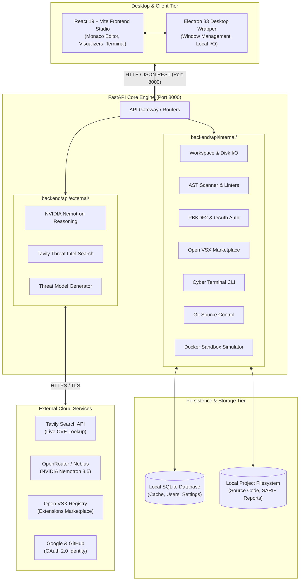
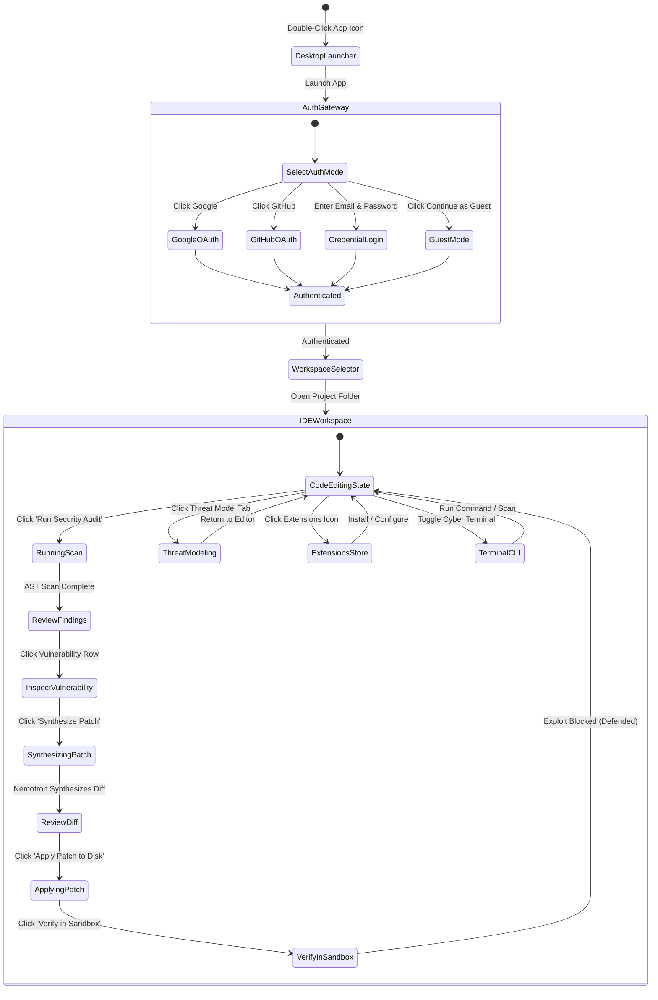

# Kestrel AI - Master Architectural & Product Blueprint
> **Hunt flaws. Ship armor.**  
> Comprehensive 6-Document System Specification & Design Guide for Kestrel AI.

---

## Document Index
1. [Document 1: Product Requirements Document (PRD)](#document-1-product-requirements-document-prd)
2. [Document 2: Technical Requirements Document (TRD)](#document-2-technical-requirements-document-trd)
3. [Document 3: Application Flow & Screen State Machine](#document-3-application-flow--screen-state-machine)
4. [Document 4: Design Brief & Brand Design System](#document-4-design-brief--brand-design-system)
5. [Document 5: Backend Schema & Data Governance](#document-5-backend-schema--data-governance)
6. [Document 6: Implementation Plan & Delivery Roadmap](#document-6-implementation-plan--delivery-roadmap)
7. [Appendix: Master Claude Generation Prompt](#appendix-master-claude-generation-prompt)

---

## Document 1: Product Requirements Document (PRD)

### 1.1 Executive Summary
Kestrel AI is an AI-native cybersecurity integrated development environment (IDE) and automated DevSecOps platform. It bridges the gap between software development, vulnerability auditing, live threat intelligence, and defensive code remediation. By pairing deterministic Abstract Syntax Tree (AST) static analysis with real-time CVE threat intelligence from Tavily and defensive code patch synthesis powered by NVIDIA Nemotron, Kestrel provides an end-to-end security studio directly inside the developer workspace.

### 1.2 Target Audience & Personas
- **Application Security Engineers**: Need deterministic vulnerability findings, reproducible SARIF reports, and verifiable exploit simulation without false positives.
- **Full-Stack Software Developers**: Want in-editor security linting, instant root cause explanations, and 1-click unified git diffs applied to disk without leaving the IDE.
- **DevSecOps Architects**: Require automated CI/CD pipeline generation (GitHub Actions, GitLab CI), compliance with OASIS SARIF 2.1.0, and strict zero-data-retention security guarantees.
- **Security Executives / Non-Technical Stakeholders**: Need clear threat visualizers, interactive attack trees, health scores (0 to 100), and plain-English risk assessments.

### 1.3 Core Features Catalog

```
+----------------------------------------------------------------------------------------------------+
|                                    KESTREL AI CORE CAPABILITIES                                    |
+------------------------------------+----------------------------------+----------------------------+
| 1. DETERMINISTIC AUDIT ENGINE      | 2. LIVE THREAT INTELLIGENCE      | 3. DEFENSIVE REMEDIATION   |
| - Python AST vulnerability scans   | - Real-time Tavily search queries| - NVIDIA Nemotron 3.5      |
| - Architectural role classifier    | - Live CVE ID and CVSS grounding | - Unified git diff output  |
| - High-entropy secret detection    | - Exploit-DB local catalog       | - 1-Click disk patching    |
| - YARA, Sigma, Snort linting       | - MITRE ATT&CK mapping           | - Scoped Ask AI assistant  |
+------------------------------------+----------------------------------+----------------------------+
| 4. EXPLOIT FUZZER & SANDBOX        | 5. THREAT MODELING & ATTACK TREE | 6. DEVSECOPS & EXTENSIONS  |
| - Docker containerized sandbox     | - Automated source-sink tracing  | - OASIS SARIF 2.1.0 export |
| - Dynamic command injection fuzzer | - Interactive SVG attack graph   | - CI/CD pipeline generator |
| - Pre-patch vs post-patch checks   | - Data flow risk indicators      | - Open VSX extension store |
+------------------------------------+----------------------------------+----------------------------+
```

#### Feature 1: Deterministic Abstract Syntax Tree (AST) Static Analyzer
- **Purpose**: Detect vulnerabilities in source code with zero LLM hallucination.
- **Supported Vulnerabilities**:
  - SQL Injection (CWE-89): Detects unparameterized raw string formatting inside database execute queries.
  - Command Injection (CWE-78): Detects subprocess calls with `shell=True` and unescaped variables.
  - Path Traversal (CWE-22): Flags unvalidated filesystem path concatenation.
  - Insecure Deserialization (CWE-502): Detects untrusted `pickle.loads` calls.
- **Architectural Role Classification**: Flags each code AST node as `SOURCE` (untrusted user input), `SINK` (dangerous function call), `VALIDATION_GAP` (missing sanitizer), or `TRIGGER_POINT` (execution vector).
- **Secrets Detector**: Regex and Shannon entropy scanner catching leaked AWS access keys, OpenAI tokens, Slack webhooks, and private RSA keys with automatic in-memory redaction.
- **Multi-Standard Security Linters**:
  - YARA Rule Linter: Checks string lengths, hex formatting, and condition syntax.
  - Sigma SIEM Rule Linter: Verifies log sources, selection rules, and detection fields.
  - Snort IDS Linter: Checks rule headers, directional operators, protocol definitions, and SID/GID uniqueness.
  - Dockerfile Linter: Flags `USER root`, unpinned base images, and insecure `curl | sh` scripts.

#### Feature 2: Live Threat Intelligence Grounding (Tavily Search)
- **Real-time Querying**: Queries the Tavily Search API for newly published Common Vulnerabilities and Exposures (CVEs) matching detected CWE patterns.
- **Metadata Extraction**: Extracts CVE identifier, published date, CVSS score (0.0 to 10.0), CVSS vector string, affected package versions, and vendor mitigation guidance.
- **Offline Fallback Catalog**: If offline or unauthenticated, falls back to a curated local Exploit-DB vulnerability reference database.

#### Feature 3: Defensive Remediation Engine (NVIDIA Nemotron)
- **Model**: `nvidia/nemotron-3.5-lightning` hosted via OpenRouter API with offline Ollama fallback (`llama3`, `deepseek-coder`).
- **Remediation Synthesis**: Synthesizes verified unified git diff patches that fix the security flaw while preserving function signatures, variable naming, and coding style.
- **Disk Application**: Applies patches directly to workspace files on disk with automated filesystem backup.
- **Ask AI Specialist**: Context-aware in-editor assistant with strict cybersecurity guardrails preventing prompt injection or off-topic queries.

#### Feature 4: Dynamic Docker Sandbox & Attack Simulator
- **Simulation Harness**: Dispatches vulnerable and patched code into isolated Docker containers or ephemeral Python subprocess sandboxes.
- **Execution Verification**: Sends simulated attack payloads (`id; whoami`, `' OR '1'='1`) against both original code and remediated code to mathematically verify patch efficacy.
- **Verdict Engine**: Yields `VULNERABLE` (exploit succeeded) or `DEFENDED` (attack payload blocked, execution handled cleanly).

#### Feature 5: Interactive Threat Modeling & Attack Trees
- **Automated Data Flow Analysis**: Scans project files to construct end-to-end data pipelines from external user entry points to backend storage.
- **Visual Attack Tree**: Renders interactive SVG nodes illustrating entry points, trust boundaries, processing logic, and persistence sinks with color-coded risk levels.

#### Feature 6: Open VSX Extension Marketplace
- **Live Registry Search**: Connects directly to the vendor-neutral Eclipse Open VSX Registry (`https://open-vsx.org/`) to search tens of thousands of extensions.
- **Curated Built-in Store**: 30+ pre-indexed extensions across 5 categories: Security, Languages, Linters, Productivity, and Themes.
- **Lifecycle Management**: Install, uninstall, enable, disable, and filter installed extensions with local state persistence.

#### Feature 7: Integrated Cyber Terminal
- **Dual Mode CLI**: Custom cybersecurity shortcut commands (`help`, `status`, `ls`, `cve`, `audit`) plus full real shell passthrough (PowerShell, Command Prompt, Bash) with terminal safeguard filters.

#### Feature 8: Production Authentication & Account Switching
- **OAuth 2.0**: Seamless Google and GitHub OAuth authentication with CSRF state protection.
- **Credential Storage**: PBKDF2-HMAC-SHA256 salted password hashing.
- **Account Switcher**: Supports multi-account profile switching and local Guest Mode.

---

## Document 2: Technical Requirements Document (TRD)

### 2.1 Technology Stack & Ecosystem

```
+----------------------------------------------------------------------------------------------------+
|                                      KESTREL TECHNOLOGY STACK                                      |
+--------------------+-------------------------------------------------------------------------------+
| LAYER              | TECHNOLOGIES & LIBRARIES                                                      |
+--------------------+-------------------------------------------------------------------------------+
| Frontend Studio    | React 19, TypeScript, Vite 8, TanStack Router, TanStack Start, Tailwind CSS    |
| Code Editor Canvas | Monaco Editor (VS Code core engine), @monaco-editor/react                     |
| Desktop Wrapper    | Electron 33, Electron-Builder (NSIS Installer, Portable Executable)           |
| Backend Core       | Python 3.11 / 3.12, FastAPI, Uvicorn (ASGI), Pydantic v2                      |
| Static Analysis    | Python AST module, PyYAML, Regular Expressions, Shannon Entropy Calculator    |
| Database & Cache   | SQLite 3 (WAL mode), Thread-safe In-Memory Session Cache                      |
| AI & LLM Engine    | NVIDIA Nemotron 3.5 Lightning (via OpenRouter API), Ollama Local Runner       |
| Threat Intel       | Tavily Search REST API, Curated Exploit-DB Local Reference Catalog             |
| Packaging Tools    | PyInstaller 6 (kestrel-core.exe), GitHub Actions CI/CD (Ubuntu/Windows)        |
+--------------------+-------------------------------------------------------------------------------+
```

### 2.2 System Architecture Diagram



### 2.3 API Route Matrix

#### Internal API Endpoints (`backend/api/internal/`)
| Endpoint | Method | Parameters | Description |
|---|---|---|---|
| `/api/workspace/tree` | GET | `root_dir` (optional) | Returns recursive directory file tree for the file explorer. |
| `/api/workspace/file` | GET | `filepath` | Reads content of selected source code file from disk. |
| `/api/workspace/file` | POST | `filepath`, `content` | Writes modified source code content back to disk. |
| `/api/workspace/open-folder` | POST | `path` | Sets active workspace root directory. |
| `/api/workspace/scan` | POST | `workspace_path` | Runs whole-repository batch AST security audit. |
| `/api/auth/register` | POST | `email`, `password`, `name` | Creates new user account with PBKDF2 password hashing. |
| `/api/auth/login` | POST | `email`, `password` | Authenticates user and returns active session token. |
| `/api/auth/guest` | POST | none | Creates ephemeral local Guest session. |
| `/api/auth/me` | GET | Session Header | Returns current active user profile and preferences. |
| `/api/extensions/search` | GET | `q`, `category`, `size` | Queries live Open VSX Registry and curated catalog. |
| `/api/extensions/installed` | GET | none | Returns list of currently installed IDE extensions. |
| `/api/extensions/install` | POST | `id`, `name`, `version` | Installs extension into local Kestrel workspace. |
| `/api/extensions/uninstall` | POST | `id` | Removes extension from local Kestrel workspace. |
| `/api/terminal/execute` | POST | `command`, `cwd` | Executes CLI command with security safeguards. |
| `/api/git/status` | GET | none | Returns git staging status and modified files. |
| `/api/git/stage` | POST | `filepath` | Stages file for git commit. |
| `/api/git/commit` | POST | `message` | Commits staged changes to local git repository. |
| `/api/sandbox/simulate` | POST | `code`, `scenario_id` | Runs exploit test against quarantined Docker container. |
| `/api/cicd/generate` | POST | `provider`, `fail_on` | Generates GitHub Actions or GitLab CI workflow YAML. |

#### External API Endpoints (`backend/api/external/`)
| Endpoint | Method | Parameters | Description |
|---|---|---|---|
| `/api/ai/ask` | POST | `question`, `cwe_id`, `filename` | Conversational security assistant with prompt guardrails. |
| `/api/remediation/synthesize`| POST | `finding_id`, `source_code` | Generates verified unified git diff patch via Nemotron. |
| `/api/remediation/apply` | POST | `filepath`, `diff_patch` | Applies unified diff directly to project file on disk. |
| `/api/intel/query-cve` | POST | `cwe_id`, `keywords` | Queries Tavily API for live CVE scores and advisories. |
| `/api/threat-model/generate` | POST | `workspace_path` | Traces source-to-sink flows and generates attack graph. |
| `/api/oauth/authorize` | GET | `provider` | Initiates OAuth 2.0 flow with CSRF token generation. |
| `/api/oauth/callback` | GET | `code`, `state` | Verifies CSRF state and exchanges code for user profile. |

---

## Document 3: Application Flow & Screen State Machine

### 3.1 Global Navigation State Machine



### 3.2 Step-by-Step User Journeys

#### Journey 1: First-Time Launch & Workspace Ingestion
1. User launches Kestrel via desktop shortcut (`Kestrel.exe`) or terminal (`run_desktop.bat`).
2. Electron boots local backend engine on `127.0.0.1:8000` and serves React UI on `127.0.0.1:8080`.
3. If not authenticated, the **Authentication Gateway** modal opens. User logs in with Google/GitHub or clicks **Guest Mode**.
4. User clicks **Open Folder**. Native OS file dialogue opens; user selects project directory.
5. Kestrel indexes project files into the left sidebar file tree and loads the active file into the Monaco Editor.

#### Journey 2: AST Security Audit & Threat Intelligence
1. User clicks the **Run Audit** button on the top toolbar.
2. Backend AST engine analyzes all files within 400 milliseconds.
3. Vulnerable code lines are decorated in the Monaco Editor with red squiggles and line margin badges.
4. The **Security Findings Drawer** populates with detected CWEs categorized by severity (`CRITICAL`, `HIGH`, `MEDIUM`, `LOW`).
5. Clicking a finding triggers Tavily live search, pulling verified CVE identifiers, CVSS scores, and mitigation notes into the right-hand **AI Inspector Panel**.

#### Journey 3: AI Defensive Remediation & Disk Patching
1. User clicks **Generate AI Patch** in the findings inspector.
2. NVIDIA Nemotron receives the code context, AST node role, and CVE advisory.
3. Nemotron outputs a standardized unified git diff patch.
4. Monaco displays a split diff preview showing before/after comparison.
5. User clicks **Apply Patch to Disk**. File is patched on the local filesystem, and AST cache is updated.

#### Journey 4: Dynamic Sandbox Simulation
1. User clicks **Simulate Attack**.
2. Kestrel launches the scenario harness against the patched file.
3. Fuzzer executes the exploit payload (e.g. `; cat /etc/passwd`).
4. Output terminal displays execution trace and gives a green **DEFENDED** badge confirming the patch successfully neutralized the vulnerability.

---

## Document 4: Design Brief & Brand Design System

### 4.1 Brand Identity & Visual Language
Kestrel's design philosophy is **Cybersecurity Precision**: modern, dark, high contrast, clean, and distraction-free. It conveys the authority of an advanced defense operations center with the ergonomics of modern code editors like VS Code and Cursor.

```
+----------------------------------------------------------------------------------------------------+
|                                    KESTREL DESIGN TOKEN SYSTEM                                     |
+------------------------------------+---------------------------------------------------------------+
| TOKEN CATEGORY                     | VALUES & HEX CODES                                            |
+------------------------------------+---------------------------------------------------------------+
| Canvas / Background Colors         | Obsidian Base: #07090E | Surface: #0D111A | Panel: #131824    |
| Border & Divider Colors            | Subtle: #1E2638 | Focus: #00F0FF | Active: #2A364F             |
| Cyber Accents                      | Electric Cyan: #00F0FF | Neon Matrix: #00FF9D | Amber: #FFB800 |
| Severity Colors                    | CRITICAL: #FF2E63 | HIGH: #FF6B4A | MEDIUM: #FFB800 | LOW: #38BDF8 |
| AI Brand Colors                    | NVIDIA Green: #76B900 | Nemotron Glow: #A3E635                 |
| Typography: Code                   | JetBrains Mono, Fira Code, Menlo, monospace (13px / 1.5 lh)   |
| Typography: UI Body                | Inter, Geist Sans, system-ui, sans-serif (12px to 14px)        |
| Typography: Headers                | Inter Semi-Bold / Bold (16px to 24px)                          |
+------------------------------------+---------------------------------------------------------------+
```

### 4.2 Workspace Layout Specifications
The Kestrel IDE interface follows a strict 4-column responsive grid:

```
+----+---------------+------------------------------------------+-----------------------+
|    |               |                                          |                       |
| A  |   B. SIDEBAR  |            C. EDITOR CANVAS              |     D. INSPECTOR      |
| C  |   EXPLORER    |             (Monaco Editor)              |    (AI Remediation    |
| T  |  - File Tree  |                                          |    & Threat Intel)    |
| I  |  - Extensions |  [Tab 1: app.py] [Tab 2: rules.yar]     |                       |
| V  |  - Findings   |  --------------------------------------- | - CVE Details         |
| I  |  - Git SCM    |  1  import os                            | - CVSS Score: 9.8     |
| T  |  - Settings   |  2  import subprocess                    | - Nemotron Analysis   |
| Y  |               |  3                                       | - Unified Diff Patch  |
|    |               |  4  def ping(host):                      | - [Apply Patch]       |
| B  |  (260px wide) |  5      # SINK (CWE-78)                  | - [Simulate Exploit]  |
| A  |               |  6      cmd = f"ping -c 3 {host}"        |                       |
| R  |               |  7      subprocess.run(cmd, shell=True)  | (380px wide)          |
|    |               |                                          |                       |
| 48 |               +------------------------------------------+                       |
| px |               |          E. CYBER TERMINAL CLI / SARIF FINDINGS DRAWER           |
|    |               |  kestrel> scan . --fail-on NEVER --sarif report.sarif            |
+----+---------------+------------------------------------------------------------------+
|                    F. STATUS BAR (Health Score: 100/100 | Port 8000 | Git: main)      |
+---------------------------------------------------------------------------------------+
```

---

## Document 5: Backend Schema & Data Governance

### 5.1 Zero Data Retention Architecture
A foundational privacy commitment of Kestrel AI is **Zero Remote Code Retention**:
- Source code files NEVER leave the local developer workstation.
- When querying NVIDIA Nemotron for patch generation, only the immediate vulnerable code function snippet is transmitted over TLS.
- High-entropy secrets (passwords, tokens, API keys) are detected and replaced with redaction placeholders (`[REDACTED_SECRET]`) in volatile memory before any prompt is dispatched to an LLM.
- Users can switch to local Ollama inference (`http://localhost:11434`) for a 100% offline, air-gapped security audit environment.

### 5.2 Local SQLite Schema Specifications (`kestrel_storage.db`)

#### 1. Table: `users`
Stores registered developer profiles and OAuth account bindings.
```sql
CREATE TABLE users (
    id TEXT PRIMARY KEY,
    email TEXT UNIQUE NOT NULL,
    hashed_password TEXT,
    salt TEXT,
    name TEXT NOT NULL,
    avatar_url TEXT,
    oauth_provider TEXT, -- 'google', 'github', or 'local'
    oauth_id TEXT,
    created_at TIMESTAMP DEFAULT CURRENT_TIMESTAMP,
    last_login TIMESTAMP DEFAULT CURRENT_TIMESTAMP
);
```

#### 2. Table: `sessions`
Tracks active authentication tokens and CSRF verification states.
```sql
CREATE TABLE sessions (
    session_token TEXT PRIMARY KEY,
    user_id TEXT NOT NULL REFERENCES users(id) ON DELETE CASCADE,
    csrf_token TEXT NOT NULL,
    is_guest BOOLEAN DEFAULT FALSE,
    expires_at TIMESTAMP NOT NULL,
    created_at TIMESTAMP DEFAULT CURRENT_TIMESTAMP
);
```

#### 3. Table: `ast_cache`
Persists file hashes and audit results to accelerate repeated repository scans.
```sql
CREATE TABLE ast_cache (
    filepath TEXT PRIMARY KEY,
    file_sha256 TEXT NOT NULL,
    mtime REAL NOT NULL,
    findings_count INTEGER DEFAULT 0,
    findings_json TEXT NOT NULL,
    last_scanned TIMESTAMP DEFAULT CURRENT_TIMESTAMP
);
```

#### 4. Table: `installed_extensions`
Tracks extensions added to the IDE workspace.
```sql
CREATE TABLE installed_extensions (
    id TEXT PRIMARY KEY,
    name TEXT NOT NULL,
    namespace TEXT,
    author TEXT NOT NULL,
    version TEXT NOT NULL,
    installed_at TIMESTAMP DEFAULT CURRENT_TIMESTAMP
);
```

#### 5. Table: `user_settings`
Stores user preferences for theme, AI provider, and scan sensitivity.
```sql
CREATE TABLE user_settings (
    user_id TEXT NOT NULL,
    setting_key TEXT NOT NULL,
    setting_value TEXT NOT NULL,
    updated_at TIMESTAMP DEFAULT CURRENT_TIMESTAMP,
    PRIMARY KEY (user_id, setting_key)
);
```

---

## Document 6: Implementation Plan & Delivery Roadmap

### 6.1 Phased Delivery Matrix

```
+----------------------------------------------------------------------------------------------------+
|                                    KESTREL IMPLEMENTATION ROADMAP                                   |
+--------------------------+-----------------------+----------------------+--------------------------+
| PHASE 1: CORE ENGINE     | PHASE 2: STUDIO IDE   | PHASE 3: AI & INTEL  | PHASE 4: EXTENSIONS & CI |
| [COMPLETED]              | [COMPLETED]           | [COMPLETED]          | [COMPLETED]              |
| - Python AST analyzer    | - React 19 + Monaco   | - Tavily Search API  | - Open VSX live store    |
| - Role classifier        | - Multi-tab workspace | - NVIDIA Nemotron 3.5| - GitHub Actions CI/CD   |
| - YARA/Sigma/Snort linters- Cyber Terminal CLI   | - Unified git diffs  | - SARIF 2.1.0 exporter   |
| - Secrets redaction      | - SQLite DB cache     | - Docker fuzzer test | - NSIS & Portable .exe   |
+--------------------------+-----------------------+----------------------+--------------------------+
| PHASE 5: DISTRIBUTION    | PHASE 6: ENTERPRISE   | PHASE 7: TEAMS COLLAB| PHASE 8: MULTI-PLATFORM  |
| [CURRENT - v1.0.0]       | [UPCOMING - Q1 2027]  | [UPCOMING - Q2 2027] | [UPCOMING - Q3 2027]     |
| - GitHub Releases v1.0.0 | - RBAC & SSO (SAML)   | - Real-time pair IDE | - macOS Universal binary |
| - 1-Line install.ps1     | - Custom AST rulesets | - Team threat trees  | - Linux AppImage / .deb  |
| - Winget manifest submission - Compliance audit logs - Shared CVE notebook | - JetBrains / VS Code ext|
+--------------------------+-----------------------+----------------------+--------------------------+
```

### 6.2 Verification & Quality Gate
- **Deterministic Test Suite**: 39 unit and integration tests passing in `tests/run_tests.py` covering AST detectors, secret redaction, CLI commands, OAuth state, Docker sandbox simulation, and Open VSX marketplace lifecycle.
- **Pytest Coverage**: 41 passed test cases across `tests/test_kestrel_core.py`, `tests/test_ast_roles.py`, and `tests/test_marketplace.py`.
- **SARIF Standard Compliance**: 100% compliant with OASIS SARIF 2.1.0 for native GitHub Code Scanning integration.
- **Static Asset Compilation**: Frontend builds in under 3 seconds using Vite with zero bundling errors.

---

## Appendix: Master Claude Generation Prompt

*Copy and paste the exact prompt below into Claude to generate visual-heavy, graph-rich, beginner-friendly documents:*

```text
You are an elite Principal Technical Product Architect and Creative Art Director specializing in developer tools and cybersecurity platforms.

I want you to generate a set of 6 highly visual, graph-heavy, modern, and easily understandable specification documents for "Kestrel AI - The AI-Native Cybersecurity IDE & DevSecOps Platform".

These documents must be so visual, intuitive, and crystal clear that even a non-technical executive or junior developer can immediately grasp every feature, tool, transition, and security control without guessing.

### Core Visual Guidelines for All Documents:
1. DESIGN & GRAPH HEAVY: Use abundant Mermaid.js diagrams (Flowcharts, State Machines, Sequence Diagrams, Architecture Topologies, Entity-Relationship diagrams).
2. REAL LOGOS & BADGES: Use official Shields.io badges and logo icons for all tools and technologies (Python, FastAPI, React, TypeScript, Monaco Editor, Electron, Tailwind CSS, Docker, SQLite, NVIDIA Nemotron, Vite, GitHub Actions, Open VSX, Tavily, etc.).
3. ASCII FLOWCHARTS & CARDS: Use structured ASCII tables, visual callout boxes, and comparative matrix tables for clear visual hierarchy.
4. ZERO TECHNICAL GUESSWORK: Detail every exact route, port, technology, color code, database column, and state transition.
5. NO EN OR EM DASHES: Do not use en dashes or em dashes anywhere in your text, comments, or diagrams. Use standard hyphens (-) or colons (:).

---

### The 6 Documents to Generate:

#### DOCUMENT 1: PRODUCT REQUIREMENTS DOCUMENT (PRD)
- What Kestrel does feature-by-feature.
- High-level value proposition: "Hunt flaws. Ship armor."
- Detailed feature breakdowns: Deterministic AST Python analyzer, Architectural Role Classifier, High-Entropy Secret Redactor, Cybersecurity Rule Linters (YARA, Sigma, Snort, Dockerfile), Live Tavily CVE Intelligence Grounding, NVIDIA Nemotron 3.5 Defensive Patch Synthesis, Dynamic Docker Sandbox Exploit Fuzzer, Interactive SVG Threat Modeling & Attack Trees, Open VSX Extension Marketplace, Cyber Terminal CLI, and DevSecOps CI/CD Automation.
- Plain-English feature summaries with real-world developer scenarios.

#### DOCUMENT 2: TECHNICAL REQUIREMENTS DOCUMENT (TRD)
- The exact tools, libraries, frameworks, and protocols Kestrel is built upon so nobody has to guess halfway through.
- Technology badge grid with real logos, exact versions, and architectural responsibilities.
- Visual component hierarchy and data flow pipeline diagrams.
- Complete API Route matrix listing every internal and external endpoint, HTTP method, parameters, and return schemas.
- Port allocations (Backend: 8000, Frontend: 8080) and memory/timeout guardrails.

#### DOCUMENT 3: APPLICATION FLOW & USER JOURNEYS
- What happens when a user clicks any button and which screen comes next.
- Visual state machine diagram showing the complete lifecycle from desktop launch through authentication, workspace opening, code editing, scanning, CVE inspection, patch synthesis, sandbox validation, threat modeling, and CI/CD export.
- Step-by-step storyboard for 4 primary user journeys with screen state transitions.

#### DOCUMENT 4: DESIGN BRIEF & BRAND DESIGN SYSTEM
- The exact visual styling, dark cyberpunk cybersecurity aesthetic, typography, and color tokens.
- Complete hex code color palette: Obsidian background (#07090E), Surface (#0D111A), Cyber Cyan accent (#00F0FF), Neon Matrix (#00FF9D), Severity colors (CRITICAL #FF2E63, HIGH #FF6B4A, MEDIUM #FFB800, LOW #38BDF8), and NVIDIA Green (#76B900).
- Typography pairings: JetBrains Mono for editor canvas, Inter / Geist Sans for UI elements.
- Visual ASCII layout wireframes detailing the 4-column workspace: Activity Bar (48px), Collapsible Sidebar (260px), Monaco Editor Canvas, and AI Inspector / Findings Drawer (380px).

#### DOCUMENT 5: BACKEND SCHEMA & DATA GOVERNANCE
- Where client data lives, who can see it, and how it is secured.
- Strict Zero Data Retention Architecture: Explaining how user code remains local on disk/memory and is never stored on backend databases or servers.
- Full SQLite 3 schema DDL with exact tables, columns, constraints, foreign keys, and indexes: `users`, `sessions`, `ast_cache`, `installed_extensions`, and `user_settings`.
- Data security guarantees: Pre-LLM secret redaction, PBKDF2 password hashing with unique salts, OAuth CSRF state verification, and local offline Ollama air-gapped mode.

#### DOCUMENT 6: IMPLEMENTATION PLAN & DELIVERY ROADMAP
- What gets built in what order with milestones, phases, and quality gates.
- Phased delivery matrix: Phase 1 (Core Engine), Phase 2 (Studio IDE), Phase 3 (AI & Intel), Phase 4 (Extensions & CI), Phase 5 (Desktop Packaging v1.0.0), and Future Enterprise Roadmap (SSO, Team Collaboration, Multi-platform).
- Testing and verification standards: Automated 39-test suite, OASIS SARIF 2.1.0 compliance, and continuous GitHub Actions build pipelines.

Begin by generating this complete visual documentation suite with maximum thoroughness, beautiful diagrams, and engaging developer-centric formatting.
```
