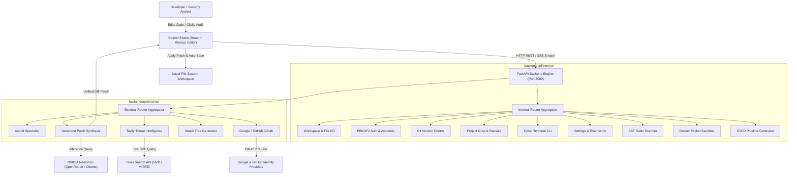

# System Architecture & Technical Specifications

## Project: Kestrel AI (AI-Native Cybersecurity IDE & DevSecOps Engine)
**Tagline:** Hunt flaws. Ship armor.

---

## 1. High-Level Architecture Diagram

---

## 2. Technology Stack

### Frontend Architecture
* **Framework:** React 18 with Vite and TanStack Start for high-performance development and bundling.
* **Code Editor:** `@monaco-editor/react` (the open-source core of VS Code) configured with custom cyber themes, AST error squiggles, and debounced auto-save.
* **UI Component Library:** Radix UI primitives styled with Tailwind CSS, Lucide React icons, and Sonner toast notifications.
* **API Client Layer:** Modular architecture partitioned into `client.ts`, `internal/` (workspace, auth, git, search, terminal, settings, scanner, sandbox, cicd), and `external/` (ai, remediation, intel, threatModel).

### Backend Architecture
* **Framework:** FastAPI (Python 3.11+) with asynchronous execution, Pydantic v2 schemas, and CORS middleware.
* **Modular Router Organization:**
  * `backend/api/internal/`: Core IDE functionality operating on the local workstation and file system.
  * `backend/api/external/`: Integrations connecting to external LLM reasoning, threat intelligence, and OAuth providers.
* **Static Analysis Engines:**
  * Python Abstract Syntax Tree (`ast` module) with architectural role tagging (`SINK`, `SOURCE`, `VALIDATION_GAP`, `TRIGGER_POINT`).
  * High-entropy regex pattern scanners with automatic credential redaction.
  * Specialized cybersecurity rule linters for YARA rules, Sigma SIEM rules, and Snort network IDS rules.
  * Dockerfile security analyzer for root user detection and unpinned base images.
* **Third-Party Integrations:**
  * **Tavily Search API:** Real-time retrieval of CVE advisories, CVSS metrics, and authoritative security bulletins.
  * **NVIDIA Nemotron:** `nvidia/nemotron-3.5-lightning:free` via OpenRouter or local Ollama for defensive reasoning and unified git diff generation.
* **Database & Persistence:**
  * Local SQLite zero-retention database for session tokens, saved accounts, and audit telemetry.
* **Packaging & Desktop Distribution:**
  * Standalone Python executable compiled via PyInstaller (`kestrel_core.spec` -> `kestrel-core.exe`).
  * Electron desktop wrapper (`electron/main.js`) with NSIS installer generation (`dist_installer/Kestrel Setup 1.0.0.exe`).

---

## 3. Data Flow & Execution Pipeline

1. **Workspace Ingestion & File Discovery:**
   - The user opens a directory on disk or selects a preset sample.
   - The workspace service safely traverses the folder tree, filtering out ignored folders (`.git`, `node_modules`, `venv`, `dist`), and sends the tree hierarchy to the frontend.

2. **Deterministic Static Audit:**
   - The user triggers a security scan or edits code.
   - The backend runs Python AST inspection, secret detectors, and rule linters in volatile memory.
   - Findings are tagged with line numbers, CWE identifiers, severity levels, and architectural roles.
   - Monaco Editor renders inline diagnostic markers (red squiggles) at the exact offending lines.

3. **Live Threat Intelligence Enrichment:**
   - For flagged vulnerabilities, Kestrel automatically queries Tavily Search for the corresponding CWE identifier.
   - Live CVE advisories, published dates, CVSS scores, and official vendor mitigations are returned and displayed in the AI Inspector panel.

4. **NVIDIA Nemotron Patch Synthesis:**
   - Nemotron ingests the vulnerable code snippet, deterministic finding, and live threat intelligence.
   - The model generates a root-cause explanation, realistic attack vector scenario, and a clean unified git diff patch.

5. **Patch Application & Disk Persistence:**
   - The user clicks "Apply Patch".
   - The frontend immediately writes the modified file to disk via `/api/workspace/write`, clears dirty state, updates the file cache, and clears the error squiggles.
   - Edits are also backed by a 1.5-second debounced auto-save hook and `Ctrl+S` keybindings.

6. **Dynamic Sandbox Verification:**
   - The developer can execute the vulnerable code and patched code inside an isolated Docker container or subprocess sandbox to verify that the attack payload is successfully neutralized.

---

## 4. Security & Performance Model

* **Zero-Knowledge Ephemeral Auditing:** Source code is analyzed in memory and is never used to train models.
* **Zero Code Execution on Static Audits:** The SAST scanner evaluates Abstract Syntax Trees without executing user code.
* **Subprocess & Container Containment:** Dynamic exploit simulations run in isolated containers with CPU/memory caps, strict execution timeouts (3 seconds), and zero network access.
* **Secret Redaction:** High-entropy credentials (AWS keys, JWT secrets, passwords) are automatically redacted before context is sent to external LLM endpoints.
