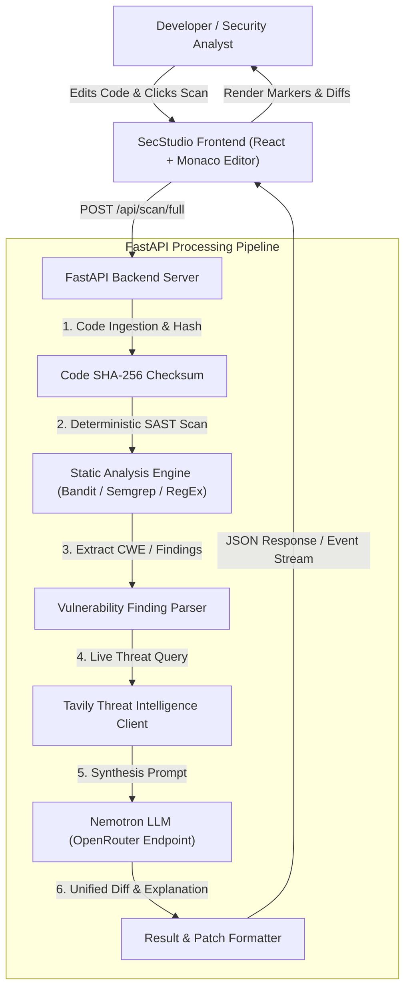

# System Architecture & Technical Specifications

## Project: SecStudio AI (AI-Native Cybersecurity IDE)

---

## 1. High-Level Architecture Diagram

---

## 2. Technology Stack

### Frontend Layer
* **Framework:** React 18 with Vite for rapid development and high performance.
* **Code Editor:** `@monaco-editor/react` (the VS Code core editor running inside the browser).
* **Styling & Design System:** Tailwind CSS with a customized VS Code dark palette (Zinc, Slate, Cyberpunk Emerald and Amber accents).
* **UI Components & Icons:** Lucide React for crisp, lightweight iconography.
* **Diff Viewer:** `diff` / `monaco-diff-editor` for side-by-side patch review and real-time merging.

### Backend Layer
* **Framework:** FastAPI (Python 3.11+), asynchronous and type-safe with Pydantic validation.
* **Static Security Analyzers:**
  * `bandit` for Python AST security analysis.
  * Specialized regex scanners for hardcoded credentials, JWT secrets, and API keys.
  * Modular adapter interface for easy expansion to Semgrep and Trivy rules.
* **Threat Intelligence Integration:**
  * Official Tavily Search Python SDK (`tavily-python`) for real-time CVE and vulnerability lookups.
* **AI Reasoning Engine:**
  * NVIDIA Nemotron (`nvidia/nemotron-3.5-lightning:free` via OpenRouter endpoint).
  * Structured JSON schema prompting for deterministic patch generation.

---

## 3. Data Flow & Execution Pipeline

1. **Client Submission:**
   * The user writes or selects code in the Monaco Editor.
   * Clicking "Run Security Audit" sends an HTTP POST request to `/api/scan/full` containing the source code, filename, and programming language.

2. **Deterministic Analysis Phase:**
   * The backend hashes the source code to support caching.
   * The static analysis engine parses the code using AST-level rules.
   * If no vulnerabilities are detected, a clean bill of health is returned immediately.
   * If vulnerabilities are detected, the engine extracts exact line numbers, code snippets, CWE IDs, and severity classifications.

3. **Threat Intelligence Grounding Phase:**
   * For each detected CWE or vulnerable package, the backend generates an optimized search query.
   * Tavily queries authoritative databases (NVD, CVE Details, GitHub Advisories) and returns the top 3 verified technical summaries.

4. **AI Reasoning & Patch Generation Phase:**
   * The backend constructs a prompt containing:
     * The vulnerable code snippet and surrounding lines.
     * The deterministic finding (CWE ID, rule name, error message).
     * The authoritative CVE advisory retrieved from Tavily.
   * Nemotron processes the input and produces:
     * An executive summary explaining the attack vector.
     * An exploit scenario detailing practical risk.
     * A unified git diff patch fixing the vulnerability.

5. **Frontend Rendering:**
   * Monaco Editor sets diagnostic markers (red squiggly lines) on affected lines.
   * The Security Panel displays categorized findings with severity badges and expandable threat intelligence notes.
   * The Remediation Panel renders an interactive diff with a single-click "Apply Patch" button that updates the editor.

---

## 4. API Endpoints Specification

### `POST /api/scan/static`
* **Input:** `{ "code": string, "language": string, "filename": string }`
* **Output:** List of deterministic findings with line numbers, CWE IDs, and severities.
* **Latency:** Under 500ms.

### `POST /api/intel/cve`
* **Input:** `{ "query": string, "cwe_id": string }`
* **Output:** Top verified CVE records and official mitigation summaries from Tavily.
* **Latency:** 1.5 to 2.5 seconds.

### `POST /api/remediate`
* **Input:** `{ "code": string, "finding": object, "threat_intel": object }`
* **Output:** Explanation narrative and git unified diff patch.
* **Latency:** 2 to 4 seconds (streamable via SSE).

### `POST /api/scan/stream` (Server-Sent Events)
* **Input:** `{ "code": string, "language": string, "filename": string }`
* **Output:** Continuous EventStream (SSE):
  * `event: finding` -> Emitted at 200ms when static scan identifies an issue (Monaco renders red squiggles).
  * `event: threat_intel` -> Emitted at 1.5s when Tavily retrieves official CVE records.
  * `event: reasoning_chunk` -> Emitted token-by-token as Nemotron streams root cause analysis.
  * `event: patch` -> Emitted with unified git diff and one-click patch payload.
  * `event: complete` -> Emitted when scan and patch cycle finishes.
* **Benefit:** Provides ultra-smooth UI feedback with zero perceived latency.

### `POST /api/webhooks/github` (DevSecOps Automation)
* **Input:** GitHub Pull Request or Push event payload with HMAC-SHA256 signature verification.
* **Output:** Automated review comment posted back to GitHub PR with vulnerability summary and diff patch.
* **Status:** 200 OK after queueing background audit task.

### `POST /api/scan/full`
* **Input:** Orchestrates static scan, threat search, and patch generation in a single batch call.

---

## 5. Scalability & Production Readiness Blueprint

For scaling from a hackathon MVP to a platform serving 10,000 to 50,000 users:

* **Asynchronous Task Queue:** Introduce Redis and Celery or BullMQ. The scan endpoint returns a `job_id` within 20ms and streams results over WebSockets or Server-Sent Events (SSE).
* **Multi-Tier Caching:**
  * SHA-256 code hash caching in Redis (identical code snippets return cached scans in under 30ms).
  * CVE and threat intel caching for 48 hours in Redis or PostgreSQL.
* **Decoupled Static Edge:** Frontend assets hosted on Cloudflare Pages or Vercel edge networks, keeping infrastructure costs close to zero.
* **BYOK Support:** Allow power users to plug in their own API keys, removing centralized inference costs.
